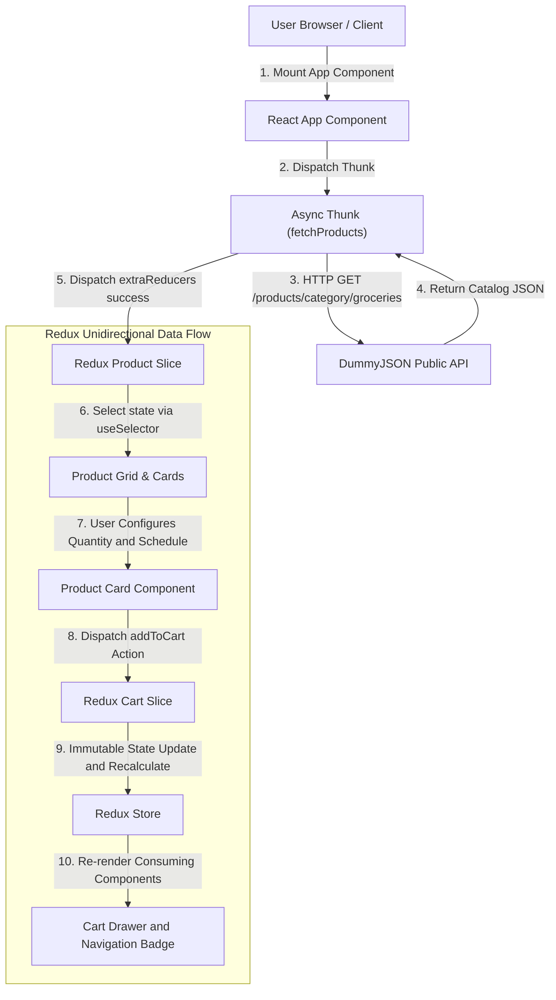

# E-Commerce Grocery Storefront Sample

This project demonstrates core **React Front-End Engineering** capabilities, focused on building hand-coded, maintainable UI architecture for e-commerce grocery and auto-replenishment systems using **TypeScript**, **Redux Toolkit (RTK)** for predictable state management, and **Tailwind CSS** for styling.

This application highlights consumable catalog filtering, subscription schedule configuration, real-time pricing recalculations, and transparent state maintenance using Redux slices, async thunks, and strongly-typed selectors.

## Technical Stack & Architecture

* **Core Library**: React 18+ & TypeScript (`.tsx`)

* **State Management**: Redux Toolkit (`@reduxjs/toolkit`, `react-redux`, `createSlice`, `createAsyncThunk`)

* **Styling**: Tailwind CSS

* **Build Tooling**: Yarn for package management & build scripts

* **Data Fetching**: Async Thunks (`createAsyncThunk`) with Native Browser `fetch()` API

* **Public API Data Source**: [DummyJSON API](https://dummyjson.com/products/category/groceries) (Consumable Groceries dataset)

## 1. System Overview & Architecture

The application fetches consumable grocery catalogs dynamically and maintains a persistent client-side shopping cart with support for **One-time Purchases** and **Autodeliver (Recurring Grocery Subscriptions)**.



## 2. TypeScript Domain Models (`src/types/grocery.ts`)

```typescript
export interface Product {
  id: number;
  title: string;
  description: string;
  price: number;
  discountPercentage: number;
  rating: number;
  stock: number;
  brand: string;
  category: string;
  thumbnail: string;
  images: string[];
}

export type DeliveryFrequency = '1-week' | '2-weeks' | '4-weeks' | '8-weeks';

export interface CartItem {
  product: Product;
  quantity: number;
  isAutodeliver: boolean;
  frequency: DeliveryFrequency;
}

export interface ProductsResponse {
  products: Product[];
  total: number;
  skip: number;
  limit: number;
}

```

## 3. Redux Toolkit State Design (Typed Slices)

### 3.1 Typed Root Store & Custom Hooks (`src/store/index.ts`)

```typescript
import { configureStore } from '@reduxjs/toolkit';
import { TypedUseSelectorHook, useDispatch, useSelector } from 'react-redux';
import productReducer from './productSlice';
import cartReducer from './cartSlice';

export const store = configureStore({
  reducer: {
    products: productReducer,
    cart: cartReducer,
  },
});

export type RootState = ReturnType<typeof store.getState>;
export type AppDispatch = typeof store.dispatch;

// Custom typed hooks for use across the application
export const useAppDispatch = () => useDispatch<AppDispatch>();
export const useAppSelector: TypedUseSelectorHook<RootState> = useSelector;

```

### 3.2 Product Slice (`src/store/productSlice.ts`)

Handles API fetching, loading states, and error boundaries with strong typing.

```typescript
import { createSlice, createAsyncThunk, PayloadAction } from '@reduxjs/toolkit';
import { Product, ProductsResponse } from '../types/grocery';

interface ProductState {
  items: Product[];
  isLoading: boolean;
  error: string | null;
  searchQuery: string;
}

const initialState: ProductState = {
  items: [],
  isLoading: false,
  error: null,
  searchQuery: '',
};

export const fetchProducts = createAsyncThunk<Product[], string, { rejectValue: string }>(
  'products/fetchProducts',
  async (searchQuery = '', { rejectWithValue }) => {
    try {
      let url = 'https://dummyjson.com/products/category/groceries';
      if (searchQuery.trim()) {
        url = `https://dummyjson.com/products/search?q=${encodeURIComponent(searchQuery)}`;
      }

      const response = await fetch(url);
      if (!response.ok) throw new Error('Failed to load grocery catalog');
      const data: ProductsResponse = await response.json();

      // Ensure catalog isolates consumable groceries
      return data.products.filter((p) => p.category === 'groceries');
    } catch (err: any) {
      return rejectWithValue(err.message || 'An error occurred');
    }
  }
);

const productSlice = createSlice({
  name: 'products',
  initialState,
  reducers: {
    setSearchQuery: (state, action: PayloadAction<string>) => {
      state.searchQuery = action.payload;
    },
  },
  extraReducers: (builder) => {
    builder
      .addCase(fetchProducts.pending, (state) => {
        state.isLoading = true;
        state.error = null;
      })
      .addCase(fetchProducts.fulfilled, (state, action: PayloadAction<Product[]>) => {
        state.isLoading = false;
        state.items = action.payload;
      })
      .addCase(fetchProducts.rejected, (state, action) => {
        state.isLoading = false;
        state.error = action.payload ?? 'Failed to fetch products';
      });
  },
});

export const { setSearchQuery } = productSlice.actions;
export default productSlice.reducer;

```

### 3.3 Cart Slice (`src/store/cartSlice.ts`)

Manages subscription states, cart visibility, quantities, and price calculations with typed selectors.

```typescript
import { createSlice, createSelector, PayloadAction } from '@reduxjs/toolkit';
import { CartItem, Product, DeliveryFrequency } from '../types/grocery';
import { RootState } from './index';

const AUTODELIVER_DISCOUNT_RATE = 0.15; // 15% off recurring orders

interface CartState {
  items: CartItem[];
  isDrawerOpen: boolean;
}

const initialState: CartState = {
  items: [],
  isDrawerOpen: false,
};

interface AddToCartPayload {
  product: Product;
  isAutodeliver: boolean;
  frequency: DeliveryFrequency;
}

interface UpdateQuantityPayload {
  productId: number;
  isAutodeliver: boolean;
  delta: number;
}

interface RemoveItemPayload {
  productId: number;
  isAutodeliver: boolean;
}

const cartSlice = createSlice({
  name: 'cart',
  initialState,
  reducers: {
    toggleDrawer: (state) => {
      state.isDrawerOpen = !state.isDrawerOpen;
    },
    addToCart: (state, action: PayloadAction<AddToCartPayload>) => {
      const { product, isAutodeliver, frequency } = action.payload;
      const existingItem = state.items.find(
        (item) => item.product.id === product.id && item.isAutodeliver === isAutodeliver
      );

      if (existingItem) {
        existingItem.quantity += 1;
      } else {
        state.items.push({
          product,
          quantity: 1,
          isAutodeliver,
          frequency,
        });
      }
      state.isDrawerOpen = true;
    },
    updateQuantity: (state, action: PayloadAction<UpdateQuantityPayload>) => {
      const { productId, isAutodeliver, delta } = action.payload;
      const item = state.items.find(
        (i) => i.product.id === productId && i.isAutodeliver === isAutodeliver
      );

      if (item) {
        const newQty = item.quantity + delta;
        if (newQty <= 0) {
          state.items = state.items.filter(
            (i) => !(i.product.id === productId && i.isAutodeliver === isAutodeliver)
          );
        } else {
          item.quantity = newQty;
        }
      }
    },
    removeItem: (state, action: PayloadAction<RemoveItemPayload>) => {
      const { productId, isAutodeliver } = action.payload;
      state.items = state.items.filter(
        (i) => !(i.product.id === productId && i.isAutodeliver === isAutodeliver)
      );
    },
  },
});

export const { toggleDrawer, addToCart, updateQuantity, removeItem } = cartSlice.actions;

// Selectors
export const selectCartItems = (state: RootState) => state.cart.items;
export const selectIsDrawerOpen = (state: RootState) => state.cart.isDrawerOpen;

export const selectTotalItemCount = createSelector([selectCartItems], (items) =>
  items.reduce((sum, item) => sum + item.quantity, 0)
);

export const selectSubtotal = createSelector([selectCartItems], (items) =>
  items.reduce((sum, item) => {
    const unitPrice = item.isAutodeliver
      ? item.product.price * (1 - AUTODELIVER_DISCOUNT_RATE)
      : item.product.price;
    return sum + unitPrice * item.quantity;
  }, 0)
);

export const selectTotalSavings = createSelector([selectCartItems], (items) =>
  items.reduce((sum, item) => {
    if (!item.isAutodeliver) return sum;
    const savingsPerUnit = item.product.price * AUTODELIVER_DISCOUNT_RATE;
    return sum + savingsPerUnit * item.quantity;
  }, 0)
);

export default cartSlice.reducer;

```

## 4. Typed React Components

### Product Card Component (`src/components/ProductCard.tsx`)

```typescript
import React, { useState } from 'react';
import { Product, DeliveryFrequency } from '../types/grocery';
import { useAppDispatch } from '../store';
import { addToCart } from '../store/cartSlice';

interface ProductCardProps {
  product: Product;
}

export const ProductCard: React.FC<ProductCardProps> = ({ product }) => {
  const dispatch = useAppDispatch();
  const [purchaseType, setPurchaseType] = useState<'once' | 'autodeliver'>('autodeliver');
  const [frequency, setFrequency] = useState<DeliveryFrequency>('4-weeks');

  const autodeliverPrice = (product.price * 0.85).toFixed(2);

  const handleAddToCart = () => {
    dispatch(
      addToCart({
        product,
        isAutodeliver: purchaseType === 'autodeliver',
        frequency,
      })
    );
  };

  return (
    <div className="bg-white border border-gray-200 rounded-lg p-4 shadow-sm flex flex-col justify-between">
      <div>
        
        <span className="text-xs font-semibold text-emerald-700 uppercase tracking-wider">
          {product.category}
        </span>
        <h3 className="font-bold text-gray-800 text-base mb-1">{product.title}</h3>
        <p className="text-xs text-gray-500 mb-3">{product.description}</p>
      </div>

      <div>
        {/* Purchase Options */}
        <div className="space-y-2 mb-4 text-xs">
          <label className="flex items-center justify-between p-2 border border-emerald-500 bg-emerald-50 rounded cursor-pointer">
            <div className="flex items-center gap-2">
              <input
                type="radio"
                name={`purchase-${product.id}`}
                checked={purchaseType === 'autodeliver'}
                onChange={() => setPurchaseType('autodeliver')}
              />
              <span className="font-medium text-gray-900">Autodeliver (15% off)</span>
            </div>
            <span className="font-bold text-emerald-700">${autodeliverPrice}</span>
          </label>

          {purchaseType === 'autodeliver' && (
            <select
              value={frequency}
              onChange={(e) => setFrequency(e.target.value as DeliveryFrequency)}
              className="w-full text-xs border border-gray-300 rounded p-1.5 bg-white"
            >
              <option value="1-week">Deliver every week</option>
              <option value="2-weeks">Deliver every 2 weeks</option>
              <option value="4-weeks">Deliver every 4 weeks</option>
              <option value="8-weeks">Deliver every 8 weeks</option>
            </select>
          )}

          <label className="flex items-center justify-between p-2 border border-gray-200 rounded cursor-pointer">
            <div className="flex items-center gap-2">
              <input
                type="radio"
                name={`purchase-${product.id}`}
                checked={purchaseType === 'once'}
                onChange={() => setPurchaseType('once')}
              />
              <span className="text-gray-700">One-time purchase</span>
            </div>
            <span className="font-semibold text-gray-800">${product.price.toFixed(2)}</span>
          </label>
        </div>

        <button
          onClick={handleAddToCart}
          className="w-full bg-emerald-600 hover:bg-emerald-700 text-white font-medium py-2 rounded text-sm transition-colors"
        >
          Add to Cart
        </button>
      </div>
    </div>
  );
};

```

## 5. Directory Structure & Installation Guide

### File Structure

```text
ecommerce-react/
├── .github/
│   └── workflows/
│       └── build-react.yml     # GitHub Actions CI/CD pipeline with yarn
├── apps/
│   └── storefront/             # React storefront application
│       ├── src/
│       │   ├── components/
│       │   │   ├── ProductCard.tsx     # Card component with subscription toggle
│       │   │   ├── ProductGrid.tsx     # Catalog container
│       │   │   ├── Navbar.tsx          # Top bar with cart item badge
│       │   │   └── CartDrawer.tsx      # Sliding cart drawer
│       │   ├── store/
│       │   │   ├── index.ts            # Typed store configuration & custom hooks
│       │   │   ├── productSlice.ts     # Catalog slice & async thunks
│       │   │   └── cartSlice.ts        # Cart items, actions & memoized selectors
│       │   ├── types/
│       │   │   └── grocery.ts          # Shared TypeScript interfaces
│       │   ├── App.tsx                 # Main layout component
│       │   └── index.tsx               # Entry point with Provider
│       ├── public/
│       │   └── index.html              # HTML entry point
│       ├── package.json
│       ├── tsconfig.json
│       ├── tailwind.config.js
│       ├── postcss.config.js
│       └── Dockerfile                  # Container image for deployment
├── LICENSE
└── README.md
```

### Installation & Local Setup

#### 1. Package Dependencies (`package.json`)

To set up this project from scratch, install core React, Redux Toolkit, and TypeScript development types:

```bash
mkdir -p apps/storefront
cd apps/storefront

# 1. Global yarn installation (run with npm or corepack)
npm install -g yarn

# 2. Core Application Dependencies
yarn add react react-dom @reduxjs/toolkit react-redux

# 3. TypeScript, Tailwind CSS, & Core Development Dependencies
yarn add -D typescript @types/react @types/react-dom @types/node tailwindcss postcss autoprefixer
yarn add -D webpack webpack-cli webpack-dev-server html-webpack-plugin ts-loader style-loader css-loader postcss-loader
yarn add -D jest ts-jest @types/jest

# 4. Initialize Tailwind CSS configuration
./node_modules/.bin/tailwindcss init -p

# 5. Code Quality, Formatting & Linting Tools
yarn add -D eslint prettier eslint-config-prettier eslint-plugin-react eslint-plugin-react-hooks @typescript-eslint/parser @typescript-eslint/eslint-plugin
```

```html
<!-- Tailwind CSS via CDN -->
<script src="https://cdn.tailwindcss.com"></script>
```

#### 2. Run Application Commands

```bash
cd apps/storefront

# Start Development Server (watch mode)
yarn start

# Run Linter (ESLint)
yarn lint

# Fix Linting Issues
yarn lint:fix

# Check Code Formatting (Prettier)
yarn format:check

# Auto-format Code
yarn format

# Run Unit & Integration Tests
yarn test

# Run Tests with Coverage Report
yarn test --coverage

# Build for Production
yarn build
```
