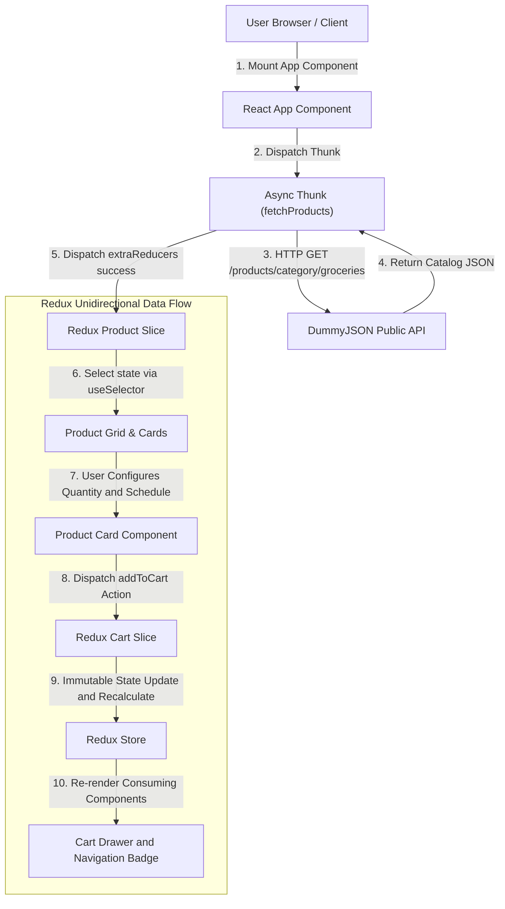

# E-Commerce Grocery Storefront Sample

This project demonstrates core **React Front-End Engineering** capabilities, focused on building maintainable UI architecture for e-commerce grocery systems using **TypeScript**, **Redux Toolkit (RTK)** for predictable state management, and **Tailwind CSS** for styling.

This application highlights consumable catalog filtering, real-time pricing recalculations, and transparent state maintenance using Redux slices, async thunks, and strongly-typed selectors.

[View the Grocery Storefront Sample](https://kelvinyap2014.github.io/ecommerce-react/)

## 1. Technical Stack & Architecture

* **Core Library**: React 18+ & TypeScript (`.tsx`)

* **State Management**: Redux Toolkit (`@reduxjs/toolkit`, `react-redux`, `createSlice`, `createAsyncThunk`)

* **Styling**: Tailwind CSS

* **Build Tooling**: Yarn for package management & build scripts

* **Data Fetching**: Async Thunks (`createAsyncThunk`) with Native Browser `fetch()` API

* **Public API Data Source**: [DummyJSON API](https://dummyjson.com/products/category/groceries) (Consumable Groceries dataset)

## 2. System Overview & Architecture

The application fetches consumable grocery catalogs dynamically and maintains a persistent client-side shopping cart with support for **One-time Purchases** and **Autodeliver (Recurring Grocery Subscriptions)**.



## 3. Directory Structure & Installation Guide

### File Structure

```text
ecommerce-react/
├── .github/
│   └── workflows/
│       └── build-react.yml     # GitHub Actions CI/CD pipeline with yarn
├── apps/
│   └── storefront/             # React storefront application
│       ├── src/
│       │   ├── components/
│       │   │   ├── ProductCard.tsx     # Card component with subscription toggle
│       │   │   ├── ProductGrid.tsx     # Catalog container
│       │   │   ├── Navbar.tsx          # Top bar with cart item badge
│       │   │   └── CartDrawer.tsx      # Sliding cart drawer
│       │   ├── store/
│       │   │   ├── index.ts            # Typed store configuration & custom hooks
│       │   │   ├── productSlice.ts     # Catalog slice & async thunks
│       │   │   └── cartSlice.ts        # Cart items, actions & memoized selectors
│       │   ├── types/
│       │   │   └── grocery.ts          # Shared TypeScript interfaces
│       │   ├── App.tsx                 # Main layout component
│       │   └── index.tsx               # Entry point with Provider
│       ├── public/
│       │   └── index.html              # HTML entry point
│       ├── package.json
│       ├── tsconfig.json
│       ├── tailwind.config.js
│       ├── postcss.config.js
│       └── Dockerfile                  # Container image for deployment
├── LICENSE
└── README.md
```

### Installation & Local Setup

#### 1. Run Application Commands

```bash
# Enable husky git commit hook for eslint and prettier automation
# at project root folder
yarn install

cd apps/storefront
yarn install

# Start Development Server (watch mode)
yarn start

# Run Linter (ESLint)
yarn lint

# Fix Linting Issues
yarn lint:fix

# Check Code Formatting (Prettier)
yarn format:check

# Auto-format Code
yarn format

# Run Unit & Integration Tests
yarn test

# Run Tests with Coverage Report
yarn test --coverage

# Build for Production
yarn build
```

#### 2. Docker & Container Deployment

```bash
cd apps/storefront

# Build production image (with optional custom API base URL)
docker build \
  --build-arg REACT_APP_API_BASE_URL=https://dummyjson.com \
  -f Dockerfile -t grocer-store:latest .

# Run container
docker run -p 8080:8080 grocer-store:latest

# Access at http://localhost:8080
```

#### 3. Background: How React, Redux, TypeScript project was setup from scratch

To set up this project from scratch, install core React, Redux Toolkit, and TypeScript development types:

```bash
mkdir -p apps/storefront
cd apps/storefront

# 1. Global yarn installation (run with npm or corepack)
npm install -g yarn

# 2. Core Application Dependencies
yarn add react react-dom @reduxjs/toolkit react-redux

# 3. TypeScript, Tailwind CSS, & Core Development Dependencies
yarn add -D typescript @types/react @types/react-dom @types/node tailwindcss postcss autoprefixer
yarn add -D webpack webpack-cli webpack-dev-server html-webpack-plugin ts-loader style-loader css-loader postcss-loader
yarn add -D jest ts-jest @types/jest

# 4. Initialize Tailwind CSS configuration
./node_modules/.bin/tailwindcss init -p

# 5. Code Quality, Formatting & Linting Tools
yarn add -D eslint prettier eslint-config-prettier eslint-plugin-react eslint-plugin-react-hooks @typescript-eslint/parser @typescript-eslint/eslint-plugin
```

```html
<!-- Tailwind CSS via CDN -->
<script src="https://cdn.tailwindcss.com"></script>
```
